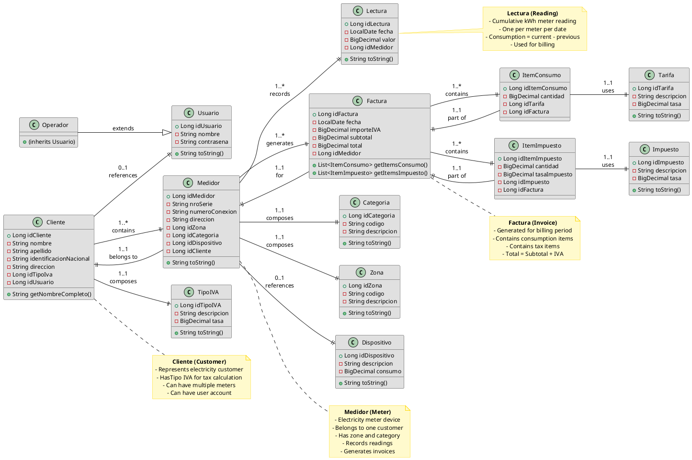
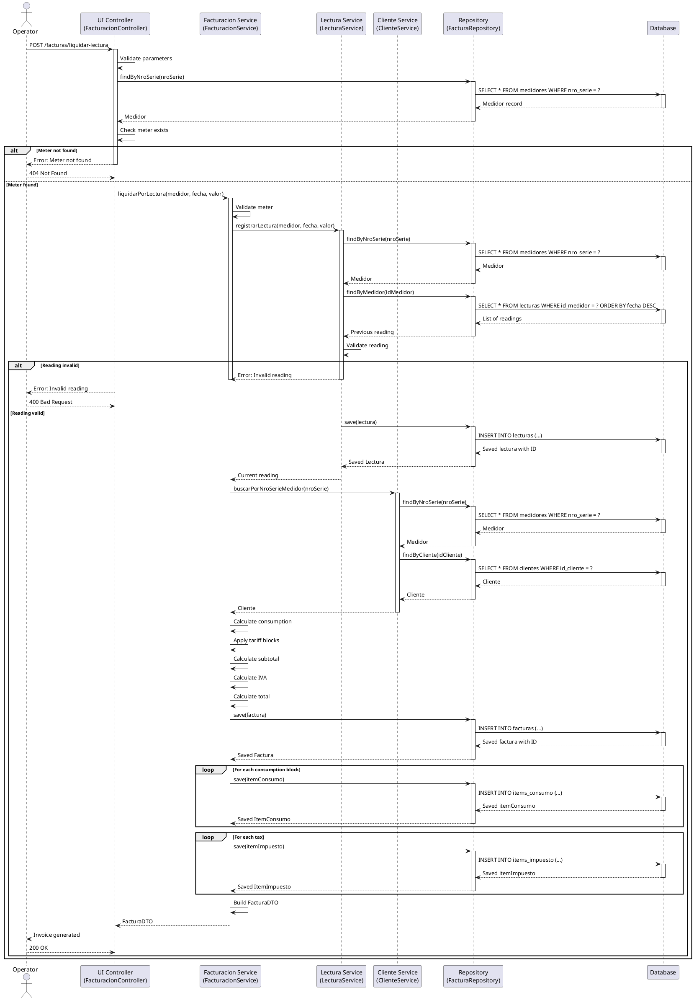
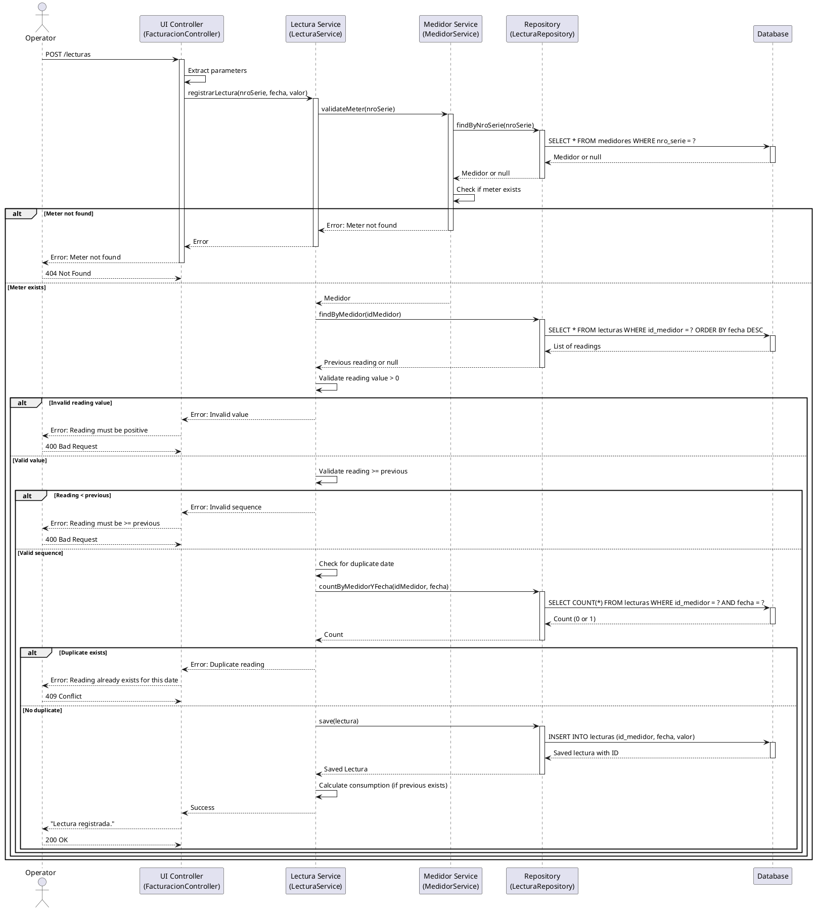
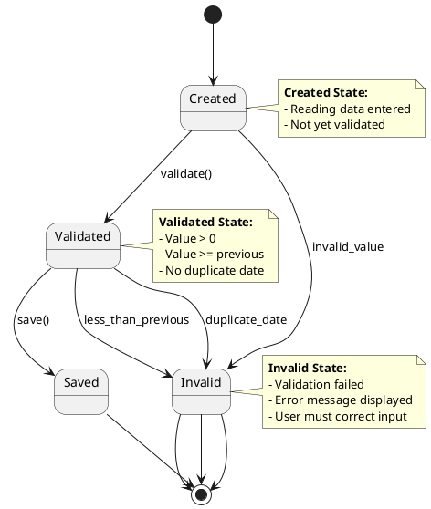
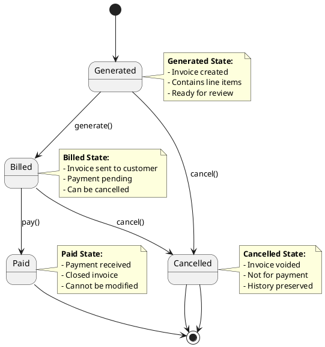

# PlantUML Diagrams

## Overview

This document contains all PlantUML diagrams for the Emsa_factura billing system. These diagrams can be rendered using any PlantUML renderer.

## Entity-Relationship Diagram

```plantuml
@startuml
' ERM - Emsa Factura Billing System
' This diagram shows the complete database schema with all relationships

' Define layout direction
left to right direction

' Define colors
skinparam rectangle {
    backgroundColor<<ENTITY>> #E0E0E0
    backgroundColor<<CATALOG>> #F0F8FF
    backgroundColor<<ENUM>> #FFFACD
    borderColor #333333
    roundCorner 10
}

skinparam {
    defaultTextAlignment center
    defaultFontName Arial
    defaultFontSize 12
    node {
        backgroundColor<<ENTITY>> #E0E0E0
        backgroundColor<<CATALOG>> #F0F8FF
        backgroundColor<<ENUM>> #FFFACD
    }
    attribute {
        backgroundColor <<PK>> #90EE90
        backgroundColor <<FK>> #87CEEB
        backgroundColor <<FK,PK>> #87CEEB
    }
}

' ==========================================
' ENTITIES
' ==========================================

<<ENTITY>> class Cliente {
  + Long idCliente [PK]
  -- 
  - String nombre
  - String apellido
  - String identificacionNacional
  - String direccion
  - Long idTipoIva [FK]
  - Long idUsuario [FK]
}

<<ENTITY>> class Usuario {
  + Long idUsuario [PK]
  -- 
  - String nombre
  - String contrasena
  - String tipoUsuario [Discriminator]
}

<<ENTITY>> class Operador <<extends>> {
  + (inherits Usuario)
}

<<ENTITY>> class Medidor {
  + Long idMedidor [PK]
  -- 
  - String nroSerie
  - String numeroConexion
  - String direccion
  - Long idZona [FK]
  - Long idCategoria [FK]
  - Long idDispositivo [FK]
  - Long idCliente [FK]
}

<<ENTITY>> class Lectura {
  + Long idLectura [PK]
  -- 
  - LocalDate fecha
  - BigDecimal valor
  - Long idMedidor [FK]
}

<<ENTITY>> class Factura {
  + Long idFactura [PK]
  -- 
  - LocalDate fecha
  - BigDecimal importeIVA
  - BigDecimal subtotal
  - BigDecimal total
  - Long idMedidor [FK]
}

<<ENTITY>> class ItemConsumo {
  + Long idItemConsumo [PK]
  -- 
  - BigDecimal cantidad
  - Long idTarifa [FK]
  - Long idFactura [FK]
}

<<ENTITY>> class ItemImpuesto {
  + Long idItemImpuesto [PK]
  -- 
  - BigDecimal cantidad
  - BigDecimal tasaImpuesto
  - Long idImpuesto [FK]
  - Long idFactura [FK]
}

<<CATALOG>> class Tarifa {
  + Long idTarifa [PK]
  -- 
  - String descripcion
  - BigDecimal tasa
}

<<CATALOG>> class Impuesto {
  + Long idImpuesto [PK]
  -- 
  - String descripcion
  - BigDecimal tasa
}

<<CATALOG>> class TipoIVA {
  + Long idTipoIVA [PK]
  -- 
  - String descripcion
  - BigDecimal tasa
}

<<CATALOG>> class Categoria {
  + Long idCategoria [PK]
  -- 
  - String codigo
  - String descripcion
}

<<CATALOG>> class Zona {
  + Long idZona [PK]
  -- 
  - String codigo
  - String descripcion
}

<<ENTITY>> class Dispositivo {
  + Long idDispositivo [PK]
  -- 
  - String descripcion
  - BigDecimal consumo
}

' ==========================================
' RELATIONSHIPS - COMPOSITION (Filled Diamond)
' ==========================================

Cliente }--|| TipoIVA : 1..1 composition\n(compose)\n0..1
Medidor }--|| Zona : 1..1 composition\n(compose)\n0..1
Medidor }--|| Categoria : 1..1 composition\n(compose)\n0..1
ItemConsumo }--|| Tarifa : 1..1 composition\n(compose)\n0..1
ItemImpuesto }--|| Impuesto : 1..1 composition\n(compose)\n0..1

' ==========================================
' RELATIONSHIPS - AGGREGATION (Open Diamond)
' ==========================================

Cliente }o--|| Medidor : 1..*\naggregation\n0..1
Usuario }o--|| Cliente : 1..*\naggregation\n0..1
Medidor }o--|| Factura : 1..*\naggregation\n0..1
Medidor }o--|| Lectura : 1..*\naggregation\n0..1
Factura }o--|| ItemConsumo : 1..*\naggregation\n0..1
Factura }o--|| ItemImpuesto : 1..*\naggregation\n0..1
Medidor }o--|| Dispositivo : 0..1\naggregation\n0..1

' ==========================================
' INHERITANCE
' ==========================================

Operador --|> Usuario : extends

' ==========================================
' NOTES
' ==========================================

note top of Cliente
  **Business Rules:**
  - Must have Tipo IVA
  - Can have multiple meters
  - Can have user account
end note

note top of Medidor
  **Business Rules:**
  - Belongs to exactly one customer
  - Has zone and category
  - Can have multiple readings
  - Can have multiple invoices
end note

note top of Lectura
  **Business Rules:**
  - Cumulative kWh reading
  - Must be >= previous reading
  - One reading per meter per date
  - Consumption = current - previous
end note

note top of Factura
  **Business Rules:**
  - One per meter per period
  - Total = Subtotal + IVA
  - Can have multiple items
  - Cannot be modified after generation
end note
@enduml
```

---

## Class Diagram



---

## Sequence Diagram - Invoice Generation



---

## Sequence Diagram - Meter Reading Registration



---

## Component Diagram

```plantuml
@startuml
' Component Diagram - Emsa Factura Billing System
' Shows the high-level components and their dependencies

' Define layout
top to bottom direction

' Define components
package "Presentation Layer" {
    component "FacturacionController\n(RestController)" as Controller
    component "SecurityConfig\n(Spring Security)" as Security
}

package "Business Logic Layer" {
    component "FacturacionService\n(Billing logic)" as FacturacionService
    component "LecturaService\n(Reading logic)" as LecturaService
    component "ClienteService\n(Customer logic)" as ClienteService
    component "MedidorService\n(Meter logic)" as MedidorService
    component "ImpuestoService\n(Tax logic)" as ImpuestoService
    component "TarifaService\n(Tariff logic)" as TarifaService
    component "TipoIVAService\n(VAT logic)" as TipoIVAService
}

package "Data Access Layer" {
    component "FacturaRepository\n(JPA Repository)" as FacturaRepo
    component "LecturaRepository\n(JPA Repository)" as LecturaRepo
    component "ClienteRepository\n(JPA Repository)" as ClienteRepo
    component "MedidorRepository\n(JPA Repository)" as MedidorRepo
    component "ImpuestoRepository\n(JPA Repository)" as ImpuestoRepo
    component "TarifaRepository\n(JPA Repository)" as TarifaRepo
    component "TipoIVARepository\n(JPA Repository)" as TipoIVARepo
}

package "Domain Model" {
    component "Factura\n(Entity)" as Factura
    component "Lectura\n(Entity)" as Lectura
    component "Cliente\n(Entity)" as Cliente
    component "Medidor\n(Entity)" as Medidor
    component "Impuesto\n(Entity)" as Impuesto
    component "Tarifa\n(Entity)" as Tarifa
    component "TipoIVA\n(Entity)" as TipoIVA
}

package "Database" {
    component "MySQL Database" as Database
}

' Define dependencies
Controller --> FacturacionService
Controller --> LecturaService
Controller --> ClienteService
Controller --> Security
Security --> Controller

FacturacionService --> FacturaRepo
FacturacionService --> LecturaService
FacturacionService --> ClienteService
FacturacionService --> ImpuestoService
FacturacionService --> TarifaService

LecturaService --> LecturaRepo
LecturaService --> MedidorService

ClienteService --> ClienteRepo
ClienteService --> MedidorRepo

MedidorService --> MedidorRepo

ImpuestoService --> ImpuestoRepo
TarifaService --> TarifaRepo
TipoIVAService --> TipoIVARepo

FacturaRepo --> Factura
LecturaRepo --> Lectura
ClienteRepo --> Cliente
MedidorRepo --> Medidor
ImpuestoRepo --> Impuesto
TarifaRepo --> Tarifa
TipoIVARepo --> TipoIVA

Factura --> Database
Lectura --> Database
Cliente --> Database
Medidor --> Database
Impuesto --> Database
Tarifa --> Database
TipoIVA --> Database

' Define notes
note top of FacturacionService
  **Business Rules:**
  - Consumption calculation
  - Tariff application
  - Tax calculation
  - Invoice generation
end note

note top of LecturaService
  **Business Rules:**
  - Reading validation
  - Duplicate prevention
  - Sequence validation
end note

note top of Database
  **Tables:**
  - clientes, usuarios, operadores
  - medidores, lecturas, facturas
  - items_consumo, items_impuesto
  - tarifas, impuestos, tipos_iva
  - zonas, categorias, dispositivos
end note
@enduml
```

---

## Deployment Architecture Diagram

```plantuml
@startuml
' Deployment Diagram - Emsa Factura Billing System
' Shows the infrastructure deployment

' Define layout
top to bottom direction

' Define nodes
node "Development/Testing Environment" {
    component "Developer\n(Mac/Windows/Linux)" as Dev
    component "Docker Desktop" as DockerDesktop
    component "MySQL 8.3 Container" as MySQLContainer
    component "Application Container" as AppContainer
}

node "Production Environment" {
    node "Kubernetes Cluster" {
        node "Worker Node" {
            pod "App Pod (Replica 1)" as Pod1
            pod "App Pod (Replica 2)" as Pod2
            pod "App Pod (Replica 3)" as Pod3
        }
        component "Kubernetes Service" as K8sService
        component "Ingress Controller" as Ingress
    }
    
    component "MySQL Cluster" as MySQLCluster
    
    component "Load Balancer" as LoadBalancer
}

' Define relationships
Dev --> DockerDesktop: Develop & Test
DockerDesktop --> MySQLContainer
DockerDesktop --> AppContainer

Dev --> K8sService: Deploy
K8sService --> Pod1
K8sService --> Pod2
K8sService --> Pod3

Pod1 --> MySQLCluster
Pod2 --> MySQLCluster
Pod3 --> MySQLCluster

LoadBalancer --> Ingress
Ingress --> K8sService

' Define clouds
cloud "External Users" as Users {
    component "Web Browser" as Browser
    component "Mobile App" as Mobile
    component "API Client" as APIClient
}

Browser --> LoadBalancer
Mobile --> LoadBalancer
APIClient --> LoadBalancer

' Define notes
note top of AppContainer
  **Container: emsa-factura:latest**
  - Java 17
  - Spring Boot 3.5.5
  - Port 8080
  - Profile: dev/test
end note

note top of Pod1
  **Pod: emsa-factura**
  - Java 17
  - Spring Boot 3.5.5
  - Port 8080
  - Profile: prod
  - Replicas: 3
end note

note top of MySQLContainer
  **Container: mysql:8.3**
  - Port 3307 (mapped to 3306)
  - Volume: emsa_mysql_data
  - Database: emsa
end note

note top of MySQLCluster
  **MySQL Cluster**
  - Primary/Replica
  - Automated backups
  - High availability
  - Read replicas for reporting
end note
@enduml
```

---

## State Diagram - Meter Reading Lifecycle



---

## State Diagram - Invoice Lifecycle



---

## Usage Instructions

### How to Render PlantUML Diagrams

1. **Online Rendering:**
   - Visit [PlantUML Live](https://www.plantuml.com/plantuml/)
   - Copy and paste the diagram code
   - Click "Submit" to render

2. **VS Code Extension:**
   - Install "PlantUML" extension
   - Open .puml file
   - Press `Alt-D` to preview

3. **Command Line:**
   ```bash
   # Using Docker
   docker run -v $(pwd):/workspace plantuml/plantuml:latest -tpng diagrams.puml
   
   # Using Java
   java -jar plantuml.jar diagrams.puml
   ```

4. **Maven Plugin:**
   ```xml
   <plugin>
       <groupId>com.github.sparsick</groupId>
       <artifactId>plantuml-maven-plugin</artifactId>
       <version>1.3.0</version>
       <executions>
           <execution>
               <goals>
                   <goal>generate</goal>
               </goals>
           </execution>
       </executions>
   </plugin>
   ```

### Diagram Files

For better organization, save each diagram to a separate `.puml` file:

```
docs/diagrams/
├── erd.puml
├── class-diagram.puml
├── invoice-generation.puml
├── reading-registration.puml
├── component-diagram.puml
├── deployment.puml
├── reading-lifecycle.puml
└── invoice-lifecycle.puml
```

---

## Summary

This document contains:

1. **Entity-Relationship Diagram** - Complete database schema
2. **Class Diagram** - Object model with relationships
3. **Sequence Diagram - Invoice Generation** - Billing workflow
4. **Sequence Diagram - Meter Reading** - Reading registration workflow
5. **Component Diagram** - System architecture
6. **Deployment Diagram** - Infrastructure setup
7. **State Diagrams** - Lifecycle workflows

All diagrams use:
- **Standard PlantUML syntax**
- **Clear layout and colors**
- **Business context notes**
- **Realistic naming conventions**

Diagrams can be rendered using any PlantUML-compatible renderer.